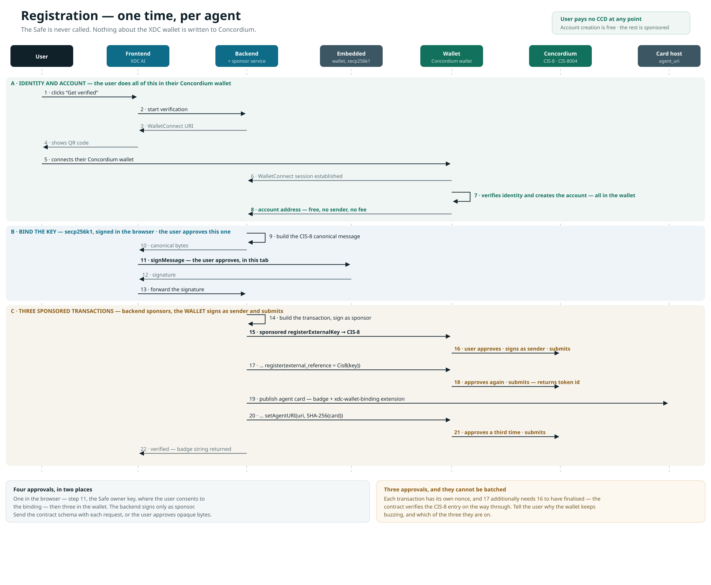
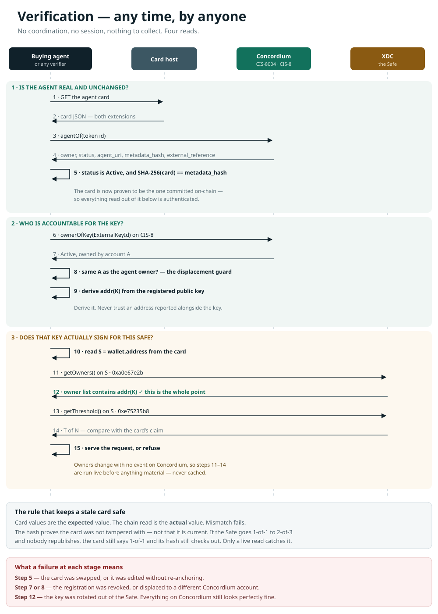

.. include:: ../../variables.rst
.. _xdc-ai-verified-agent-wallets:

===============================================
How XDC AI verifies agent wallets on Concordium
===============================================

.. admonition:: In production

   - **Partner:** `XDC AI <https://xdcai.tech>`__ gives AI agents a wallet on the XDC Network and lets them pay for APIs by the call.
   - **What they built:** Every selling agent carries a *Verified by Concordium* badge that binds its XDC smart wallet to an identity-verified Concordium account. Any buyer can check the binding without trusting XDC AI.
   - **Concordium capabilities used:** Concordium ID, the :doc:`CIS-8 External Key Registry <../../technical-reference/agent-registry/cis-8>`, the :doc:`CIS-8004 Agent Registry <../../technical-reference/agent-registry/cis-8004>`, the :doc:`Verified by Concordium badge <../../technical-reference/agent-registry/concordium-badge>`, and :doc:`sponsored transactions <../transactions/sponsored-transactions>`.
   - **Networks:** Concordium Mainnet and XDC Network (``eip155:50``).
   - **Last reviewed:** October 2026.

XDC AI's own documentation covers what a seller does on their platform. This page covers what happens on Concordium and why it is built this way, so that you can reuse the same pattern for any smart-contract wallet on any EVM chain.

The question an EVM address cannot answer
=========================================

An agent asks to be paid. Before sending money, the other side wants one thing settled: is there a real, accountable party behind this agent?

An EVM address cannot answer that. Anyone can generate one, for nothing, in any quantity. Reputation scores and self-declared profiles do not answer it either. They describe behaviour, not accountability.

Concordium answers it at the protocol layer. An account cannot exist without an identity. Every account is created from an identity issued by a regulated :term:`identity provider <Identity Provider>` who verified a real-world document, and :term:`privacy guardians <Privacy guardian (PG)>` can disclose the holder to a court or tax authority under legal process. See :doc:`Identity disclosure processes <../identity/identity-disclosure-processes>`.

That is what the badge carries across to XDC: not a reputation, but an accountable party.

Why a smart wallet cannot be bound directly
===========================================

The agent's wallet is a *Safe*, a smart-contract account. It has no private key, so it can never produce a signature. It can only answer the ERC-1271 ``isValidSignature`` call, and that answer is chain state on XDC that a Concordium contract cannot read.

So the wallet cannot be bound to an identity directly. The binding is made in two legs, each independently checkable.

.. graphviz::
   :align: center

   digraph two_legs {
      rankdir=TB;
      nodesep=0.4;
      ranksep=0.9;
      node [shape=box, style="rounded,filled", fillcolor="#f0f6f4", color="#12715c", fontcolor="#10212a", fontsize=11, margin="0.25,0.12"];
      edge [fontsize=10, color="#5d7079", fontcolor="#5d7079", labeldistance=2];
      account [label="Concordium account\nidentity-backed by an identity provider"];
      key [label="Owner key\nsecp256k1 EOA that signs for the Safe"];
      safe [label="The Safe\nsmart-contract account, cannot sign"];
      account -> key [label="Leg 1: CIS-8 signature on Concordium\nrecorded once, permanent"];
      key -> safe [label="Leg 2: getOwners() read on XDC\nread live, every time it matters"];
   }

The first leg is a signature, recorded permanently on Concordium. The second is a live read on XDC. Together they say: this identity-verified account controls a key, and that key signs for this wallet.

Signing with the XDC wallet alone would prove nothing about the Concordium account. That is why there are two legs.

What goes on chain
==================

Three transactions on Concordium, in this order. The order is not a convention. The contract enforces it.

#. **Register the key** with ``registerExternalKey`` on the CIS-8 contract. The owner key signs a canonical message naming the Concordium account, the registry, and the genesis hash. CIS-8 verifies that signature by public-key recovery and records the binding. This is the durable half: it stays true until revoked.

#. **Mint the badge** with ``register`` on the CIS-8004 contract, passing an ``external_reference`` that points at the CIS-8 entry. The contract performs a cross-contract check before accepting it: the registry must be the one it is configured with, and ``ownerOfKey`` must return *Active* and owned by the sender. So the first transaction must have finalized, and the agent must be registered by the same account that owns the key. The agent NFT is minted to the sender, which is what makes ``owner_account`` the accountable party.

#. **Anchor the card** with ``setAgentURI`` on the CIS-8004 contract. This publishes the Agent Card URL and commits the card's SHA-256 hash on chain. From then on, the card cannot be swapped without the chain revealing a mismatch.

   Registration happens once per agent. The Safe is never called, and nothing about the XDC wallet is written to Concordium.

What the seller does
--------------------

The seller uses two tools. The first is a Concordium wallet, either the |cryptox| on a phone or the |bw| in the browser, which holds the seller's Concordium identity and account and is connected to XDC AI's site. The second is XDC AI's web app, which holds the secp256k1 key that owns the Safe.

.. list-table::
   :header-rows: 1
   :widths: 6 24 70

   * - Step
     - Tool
     - Action
   * - 1
     - Concordium wallet
     - Verify identity: a passport and a liveness check, reviewed by an identity provider.
   * - 2
     - Concordium wallet
     - Create a Concordium account. This is free: a credential deployment has no sender, so there is no fee.
   * - 3
     - XDC AI web app
     - Sign the CIS-8 canonical message with the key that owns the Safe. This is a message, not a transaction.
   * - 4
     - Concordium wallet
     - Approve ``registerExternalKey`` on CIS-8.
   * - 5
     - Concordium wallet
     - Approve ``register`` on CIS-8004.
   * - 6
     - Concordium wallet
     - Approve ``setAgentURI`` on CIS-8004.

Steps 1 and 2 happen once, ever. A seller verifying a second agent starts at step 3.

The three approvals cannot be batched. Each transaction has its own sequence number, and the second additionally needs the first to have finalized, because the contract verifies the CIS-8 entry on the way through. XDC AI tells the seller why the wallet keeps asking, and which of the three approvals they are on.

The seller never pays CCD
=========================

Account creation is a credential deployment. It has no sender account, so there is nothing to charge. The three transactions above are :doc:`sponsored transactions <../transactions/sponsored-transactions>`: XDC AI signs as sponsor and pays the fee, while the seller remains the sender and therefore the accountable owner.

In the wallet this is visible. The signature request shows the contract, the entrypoint, the decoded parameter, and a **Free Transaction** marker.

.. code-block:: text

   Signature request
   xdcai.tech suggests a transaction

   Update Smart Contract Instance
   Contract index (subindex)   10082 (0)
   Contract and function name  CIS-8004.setAgentURI
   Amount                      CCD0.00
   Transaction fee             Free Transaction
   Parameter                   { "agent_uri": { "Some": [ "<agent card url>" ] } }

The parameter renders as JSON rather than hex because the request carries the contract schema. This is worth doing: the seller is approving three transactions in a row, and they should be able to read each one.

What a buyer can check, without asking anyone
=============================================

Every verified agent publishes an :doc:`Agent Card <../../technical-reference/agent-registry/agent-card>` carrying two A2A extensions. XDC AI publishes a live card for each agent, for example `this one <https://xdcai.tech/api/agent-card/Mf22qtqn8qDosqQudDKxh>`__. The examples below follow its structure, with the agent-specific values replaced by placeholders.

The first extension is the :doc:`Verified by Concordium badge <../../technical-reference/agent-registry/concordium-badge>`. Its format and verification steps are specified on the badge reference page. Note the ``externalReference`` block, which mirrors the CIS-8 entry that the agent record points at on chain.

.. code-block:: json

   {
     "uri": "https://docs.concordium.com/a2a-extensions/concordium-badge/v1",
     "params": {
       "chain": "ccd:9dd9ca4d19e9393877d2c44b70f89acb",
       "network": "Concordium Mainnet",
       "contracts": { "cis8": "10081,0", "cis8004": "10082,0" },
       "tokenAddress": "ccd:9dd9ca4d19e9393877d2c44b70f89acb/cis-2:<token address>",
       "tokenAddressBase58": "<token address>",
       "tokenId": "<token id>",
       "owner": {
         "account": "<Concordium account>",
         "caip10": "ccd:9dd9ca4d19e9393877d2c44b70f89acb:<Concordium account>"
       },
       "externalReference": {
         "kind": "Cis8",
         "contractAddress": "10081,0",
         "namespace": "eip155:50",
         "keyType": "secp256k1-compressed",
         "publicKey": "<33-byte compressed public key>"
       },
       "verify": "Resolve tokenAddress via CIS-8004 agent_of; confirm owner + status=Active + card SHA-256 == metadata_hash."
     }
   }

The second extension is XDC AI's own. It describes the XDC wallet leg and, which is the point, tells a verifier exactly how to check it.

.. code-block:: json

   {
     "uri": "https://concordium.com/a2a-extensions/xdc-wallet-binding/v1",
     "params": {
       "bindingSpec": "xdc-wallet-binding/v1",
       "claim": "sole-controller",
       "ownerKey": {
         "keyType": "secp256k1-compressed",
         "namespace": "eip155:50",
         "publicKey": "<33-byte compressed public key>",
         "registry": "ccd:9dd9ca4d19e9393877d2c44b70f89acb:contract:10081,0"
       },
       "wallet": {
         "address": "eip155:50:<Safe address>",
         "ownerCount": 1,
         "threshold": 1
       },
       "verify": {
         "chain": "eip155:50",
         "calls": [
           { "selector": "0xa0e67e2b", "to": "<Safe address>",
             "expect": "owners contains the address derived from ownerKey.publicKey" },
           { "selector": "0xe75235b8", "to": "<Safe address>",
             "expect": "threshold equals 1" }
         ]
       },
       "trustNotes": [
         "Owner set and threshold are read live from XDC. They can change with no event on Concordium, so do not cache this check.",
         "This Safe has a module enabled that can move funds within a preset limit without an owner signature, so the owner set is not an exhaustive list of what can spend."
       ]
     }
   }

``0xa0e67e2b`` is the Safe's ``getOwners()`` selector and ``0xe75235b8`` is ``getThreshold()``. The selectors, the Safe address, and the expected results are all in the card, so a buyer's agent runs the XDC half without reimplementing anything.

   Verification can run at any time, by anyone. There is no coordination, no session, and nothing to collect.

The full check
--------------

The Concordium half is the standard badge check described under *Resolve and verify a badge* on the :doc:`badge reference page <../../technical-reference/agent-registry/concordium-badge>`: resolve the badge to a contract and token ID, confirm the agent is *Active* and note its owner, fetch the card and confirm its SHA-256 hash equals the on-chain ``metadata_hash``, then confirm ``ownerOfKey`` on CIS-8 returns *Active* and owned by that same account.

The XDC half is specific to this pattern:

#. Derive the EVM address from the registered public key. Derive it. Never trust an address reported alongside the key.
#. On XDC, ``getOwners()`` on the Safe must contain that address, and ``getThreshold()`` must match the card.

Concordium answers who is accountable. XDC answers whether the key still speaks for the wallet. Neither half needs XDC AI.

Expected values and actual values
=================================

Card values are the expected value. The chain read is the actual value. A mismatch fails.

The on-chain hash proves the card has not been tampered with. It does not prove the card is still true. If a Safe's owner set changes and nobody republishes, the card still says what it said, and its hash still checks out. Only comparing against a live read catches that.

That is why the XDC half is run live, not cached.

What this proves and what it does not
=====================================

**It proves** that an identity-verified person or company, accountable under legal process, controls a key; that the key is an owner of this specific Safe; and that the published card is exactly the one committed on chain. No personal data is disclosed to anyone checking.

**It does not prove:**

- **That the owner set will still be the same in a minute.** Safe owners change by ordinary transaction, with no event on Concordium. This is the weakest joint in the design, and it is why the check is live.
- **That the owner set is exhaustive over who can spend.** A Safe module can move funds without an owner signature. XDC AI's cards say so explicitly in the second trust note above. A trust signal that states its own limits is worth more than one that hides them.
- **That the agent behaves well.** This is an identity binding, not a reputation system. It tells you who is accountable if something goes wrong, not that nothing will.
- **That the party is vetted.** An identity provider checks who someone is, not whether they are fit to operate an agent. Accountable is not the same as approved.

Reuse this pattern
==================

Nothing in this pattern is specific to XDC beyond the chain identifier and the fact that the wallet is a Safe. CIS-8 is chain-agnostic by design: ``eip155:50`` here, but equally any other EVM chain, Solana, or Cosmos.

**Specific to XDC AI:**

- The ``xdc-wallet-binding/v1`` extension and its trust notes.
- The choice of a Safe as the agent wallet, and therefore the ``getOwners()`` and ``getThreshold()`` reads.
- The sponsor service that pays the fees.

**General to any integration:**

- A Concordium account as the accountable anchor, created through an identity provider.
- CIS-8 to bind that account to a key on another chain.
- CIS-8004 to mint the agent record with an ``external_reference`` to the CIS-8 entry.
- A live read on the other chain to confirm the key still controls the wallet.
- Sponsored transactions so the user never needs CCD.

To build it yourself:

- :doc:`Use the Agent Registry <../../how-to/integrations/agent-registry>` for the registration steps, including linking an external key.
- :doc:`CIS-8: External Key Registry <../../technical-reference/agent-registry/cis-8>` for key types, proof schemes, and canonical bytes.
- :doc:`CIS-8004: Agent Registry <../../technical-reference/agent-registry/cis-8004>` for the agent record and its entrypoints.
- :doc:`Verified by Concordium badge <../../technical-reference/agent-registry/concordium-badge>` for embedding and verifying the badge.
- :doc:`Agent Card <../../technical-reference/agent-registry/agent-card>` for the card document that satisfies both ERC-8004 and A2A.
- :doc:`MCP service <../../technical-reference/agent-registry/mcp-service>` for the tools that build the canonical bytes and the transaction payloads.
- :doc:`Protocol-level sponsored transactions <../../tutorials/protocol-level-sponsored-transactions/index>` for setting up a sponsor service.
- :doc:`CAIP identifiers <../../technical-reference/caip-identifiers>` for the ``ccd:`` token and contract address formats used in the card.

The hard part of agent payments is not moving money. It is knowing who you are paying.
